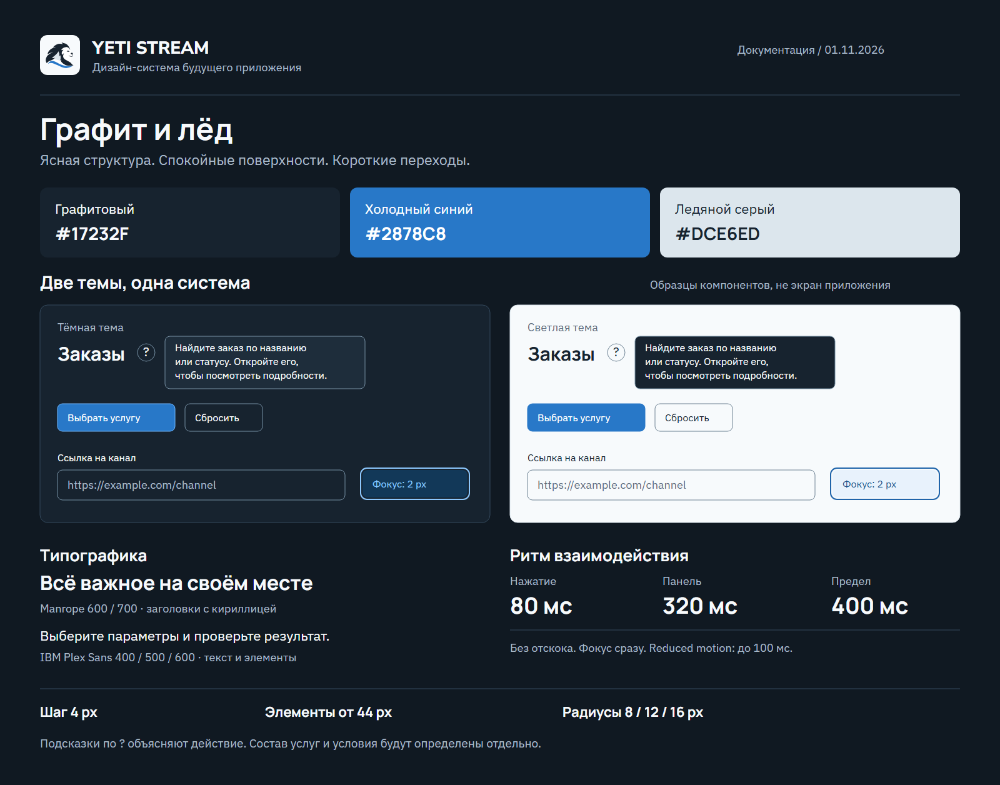

# YETI STREAM

Документация будущего веб-сервиса управления продвижением стриминговых каналов. Сейчас подготовлены визуальная система, описание сценариев и правила для ИИ-агентов разработки. Реализация приложения ещё не начата.

## Посмотреть в браузере

Откройте [design-system.html](design-system.html) двойным щелчком из папки проекта или перетащите файл в Chrome / Edge. Сервер, установка пакетов и интернет для просмотра не нужны. Сохраните рядом logo.svg, logo-dark.svg, tokens.css и каталог docs/design — витрина использует относительные пути.

Внутри: светлая, тёмная и системная темы, палитра с копированием HEX, единый локальный шрифт Rubik 400–700, кнопки и статусы, вкладки, аккаунт с выбором темы иконками во всплывающем окне, меню «Настройки» / «Оплата», выходом и тестовыми панелями, форма, полный набор полей (checkbox, radio, select, textarea, число с единицей и read-only), справка по `?`, диалог и примеры переходов до 800 мс. Это интерактивная документация; формы не отправляют и не сохраняют данные. [Подробности и проверка витрины](docs/design/showcase.md).

При запущенном локальном сервере: [дизайн-система на порту 100](http://127.0.0.1:100/). На этом порту доступны только витрина и её ресурсы; список файлов и остальные документы не выдаются. Команда повторного запуска приведена в инструкции просмотра.

## С чего начать

| Документ | Что в нём |
| --- | --- |
| [AGENTS.md](AGENTS.md) | Обязательные правила работы по всему проекту |
| [DESIGN.md](DESIGN.md) | Зафиксированное направление дизайна и карта спецификаций |
| [Продукт](docs/product.md) | Назначение, четыре зоны, сущности и сценарии |
| [Основы](docs/design/foundations.md) | Палитра, типографика, логотип, сетка, темы |
| [Компоненты](docs/design/components.md) | Размеры, состояния, поведение и доступность |
| [Экраны](docs/design/screens.md) | Состав и компоновка будущих экранов |
| [Вход и регистрация](docs/design/auth.md) | Google, Яндекс, Telegram, Kick, email; восстановление и рекомендации |
| [Анимации](docs/design/motion.md) | Матрица переходов до 800 мс |
| [Тексты и справка](docs/design/content.md) | Тултипы с `?`, терминология и готовые примеры |
| [Инженерные правила](docs/engineering.md) | Асинхронность, скорость, данные и доступ |
| [Промпты агентов](docs/agent-prompts.md) | Шаблоны для будущих задач и проверки |
| [Решения](docs/decisions.md) | Что определено, что предложено и что надо уточнить |
| [Проверка](docs/design/verification.md) | Результат проверки документации и будущий ручной чек-лист |
| [Источники](docs/design/sources.md) | Применённые навыки, плагин и официальные материалы |
| [tokens.css](tokens.css) | Канонические токены, не подключённые к приложению |
| [HTML-витрина](design-system.html) | Дизайн-система с интерактивными примерами для локального просмотра |

## Визуальное направление

[Посмотреть формы входа, регистрации и восстановления](design-system.html#auth). Внешние сервисы и письма имитируются локально, реальные аккаунты не создаются. Сервисы доступны только во входе: первый успешный вход автоматически создаёт аккаунт, повторный открывает существующий. Обычная регистрация требует имя, email и двукратный ввод пароля. Вход через провайдера не требует дополнительного email. [Инструкция и открытые решения](docs/design/auth.md).

Статический SVG/PNG-лист архивный: сохраняет прежний логотип, Nunito Sans / Manrope / IBM Plex Sans и исходные длительности анимаций. Актуальные логотипы и длительности смотрите в HTML-витрине, [инструкции логотипа](docs/design/logo.md) и tokens.css.

[Открыть векторный лист](docs/design/visual-spec.svg). Это статический лист документации: палитра, типографика, примеры элементов и размеры. Он не является интерактивным прототипом или утверждённым составом услуг. Не включать visual-spec.svg и visual-spec.png в рабочую сборку приложения; использовать актуальные logo.svg / logo-dark.svg и отдельные компоненты.

## Границы текущего этапа

- `/` остаётся пустой главной страницей.
- `/app`, `/admin`, `/partners` зафиксированы как будущие зоны, но маршрутизатор не создан.
- Состав услуг, бизнес-условия, интеграции и технологический стек открыты.
- Финальный логотип: [светлый](logo.svg) / [тёмный](logo-dark.svg), [инструкция](docs/design/logo.md). Исходная геометрия знака сохранена в [logo-mark.svg](logo-mark.svg).
- Нет package.json, зависимостей, приложения и команд запуска приложения. Автотесты отложены.
- HTML-витрина не занимает `/` и не создаёт `/app`, `/admin` или `/partners`.

Дата базовой спецификации: 1 ноября 2026 года.
