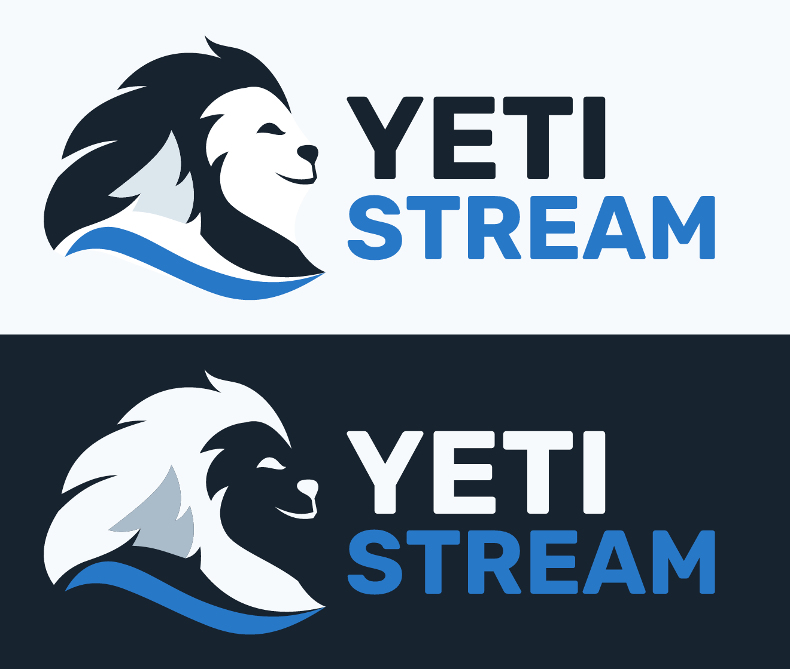

# Финальный логотип YETI STREAM

Уточнение от 1 ноября 2026 года. Визуальный ориентир — [изображение пользователя](assets/logo-reference.png): йети слева, справа YETI над STREAM, массивные буквы с небольшим скруглением углов. Это уточнение заменяет прежнее требование Nunito Sans ExtraBold 800 и светлой подложки в тёмной теме.

## Шрифт и воспроизведение

Для воспроизведения выбран **Rubik Bold 700**. По характеру углов и пропорциям он близок к образцу; точный шрифт растрового изображения не установлен. Не утверждать, что исходное изображение набрано именно Rubik. [Описание Google Fonts](https://github.com/google/fonts/blob/main/ofl/rubik/DESCRIPTION.en_us.html) подтверждает слегка скруглённые углы; [метаданные](https://github.com/google/fonts/blob/main/ofl/rubik/METADATA.pb) — семейство и кириллицу.

Это векторное воспроизведение композиции, не пиксельная копия растра. Геометрия существующего знака сохранена. Буквы получены из настоящего начертания Rubik 700 без синтетического утолщения, переведены в кривые; обе строки имеют собственный кегль с сохранением пропорций глифов. Градиентная фактура растра не переносится: цвета плоские по палитре проекта.

## Файлы и темы

| Назначение | Файл |
| --- | --- |
| Полный логотип, светлая поверхность | [logo.svg](../../logo.svg) |
| Полный логотип, тёмная поверхность | [logo-dark.svg](../../logo-dark.svg) |
| Только знак, светлая поверхность | [logo-mark.svg](../../logo-mark.svg) |
| Только знак, тёмная поверхность | [logo-mark-dark.svg](../../logo-mark-dark.svg) |
| Редактируемый текстовый образец | [Rubik variable WOFF2, использовать вес 700](assets/fonts/rubik-400-700.woff2), [OFL](assets/RUBIK-OFL.txt) |

Светлая версия: силуэт, лицо в деталях и YETI `#17232F`, белая область лица `#FFFFFF`, ледяная деталь `#DCE6ED`, поток и STREAM `#2878C8`. Тёмная версия: силуэт, детали лица и YETI `#F7FAFC`, область лица и просвет над потоком `#17232F`, ледяная деталь `#AABBC9`, поток и STREAM `#2878C8`. Тёмная версия предназначена для поверхностей `#101922` / `#17232F` / `#1E2D3B`; светлая плашка не нужна. Дополнительные цвета взяты из существующей палитры tokens.css.

Выбирать готовый файл по фактически применённой теме: ручной выбор имеет приоритет, иначе системная тема. Не применять CSS-фильтры, произвольную перекраску, обводку, растяжение или анимацию знака. Одинаковые viewBox обеих версий сохраняют компоновку при переключении.

## Размер и доступность

Полный логотип: viewBox `250 160 1320 560`, соотношение `33:14`, ширина от 180 CSS px. Высота автоматическая; резервировать размеры до загрузки. Свободное поле вокруг рисунка — не менее 8% высоты логотипа. Для меньшей области использовать отдельный знак от 40 × 40 CSS px; его исходный квадратный viewBox сохранён. Мелкие размеры 24/32 px пока не утверждены.

Подключать готовый SVG как изображение, не пересобирать надпись HTML-текстом. Самостоятельному изображению дать alt="YETI STREAM". В ссылке с доступным именем использовать alt=""; скрытая тематическая копия должна иметь display:none, чтобы имя не дублировалось. Если SVG вставлен inline, сохранять title / desc и уникальные ID для каждого экземпляра.

`--font-wordmark: "Rubik", "Segoe UI", sans-serif` и `--font-weight-wordmark: 700` задают текстовую часть бренда; по следующему уточнению пользователя Rubik 400–700 также используется во всём проекте. Готовые SVG не загружают шрифт. Общий локальный variable WOFF2 подключается ранним @font-face и preload с font/woff2 и crossorigin; font-display:swap и font-synthesis:none.
