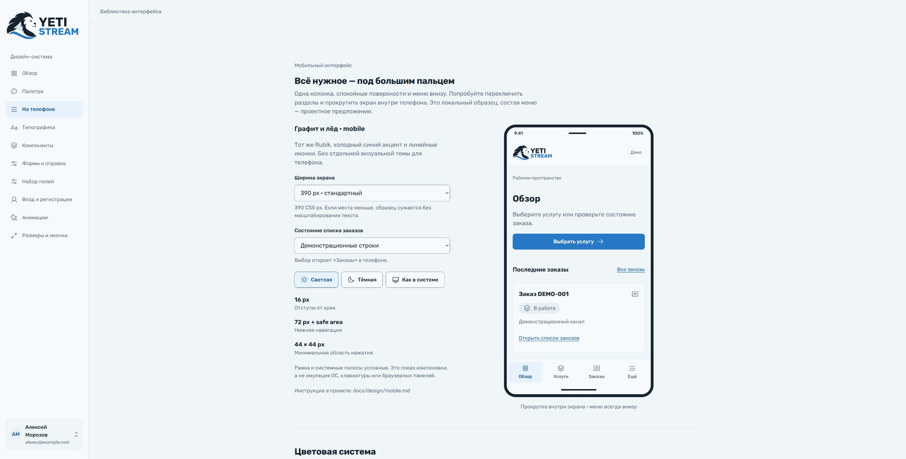

# Мобильный интерфейс YETI STREAM

Редакция от 2 ноября 2026 года. [Образец в рамке телефона](../../design-system.html#mobile). Правила применяются к оболочке `/app`; рамка телефона остаётся отдельной документационной демонстрацией. Будущие бизнес-разделы не создаются этим изменением.

## Стиль и компоновка

«Графит и лёд» сохраняется на телефоне: семантические цвета из [tokens.css](../../tokens.css), локальный Rubik, Phosphor Regular. Светлая и тёмная темы имеют одинаковую структуру. Фон страницы отделён от спокойных рабочих поверхностей; без градиентов, свечения и декоративных KPI.

На ширине 320–767 CSS px — одна колонка с горизонтальными отступами 16 px. Шапка от 64 px: готовый логотип нужной темы и только необходимые контекстные действия. Заголовок страницы 24/30 px, основной текст и поля 16/24 px, подписи меню 12 px с возможностью переноса. Размер и вес подписей при выборе не меняются. Панели имеют радиус 12 px, поля и кнопки — 8 px. Самостоятельные объекты можно отделять карточками; не оборачивать каждый абзац в панель.

Основная кнопка занимает доступную ширину там, где это помогает работе одной рукой. Она остаётся в потоке после описания задачи или итогов формы. Нижнее меню не содержит кнопку создания заказа и не конкурирует с основным действием.

## Постоянное меню снизу

Пункты основной навигации сразу открывают содержимое выбранного раздела. На телефоне используется нижнее меню, на планшете — панель по кнопке, на десктопе — sidebar. Основные разделы «Тестовая 1 / Тестовая 2» не дублировать вкладками в рабочей области. Внутри профиля на всех ширинах сохранять локальные вкладки «Настройки / Оплата»: меню аккаунта открывает выбранную вкладку и скрывается, после чего вкладки позволяют переходить между подразделами без повторного открытия меню. В тестовых разделах вкладки профиля не показывать. Заголовок, адрес и активное содержимое соответствуют выбору; при переходе из меню фокус получает заголовок, при переключении локальных вкладок фокус остаётся на вкладке. Соблюдать равные доли ширины, иконки, видимые подписи, клавиатурные стрелки и crossfade 440 мс (reduced motion до 100 мс). Вкладки авторизации сохраняются.

По уточнению пользователя левое меню на телефоне 320–767 CSS px заменяется только постоянной нижней навигацией. Sidebar, выезжающая слева панель и кнопка «Меню» на телефоне запрещены. Если открытая на планшетной ширине боковая панель попадает на телефонную ширину, она закрывается, блокировка прокрутки снимается, фокус переносится к заголовку содержимого. При смене типа навигации закрывается и меню аккаунта; фокус не возвращается на скрытый триггер. Нижняя навигация занимает всю ширину, имеет непрозрачную поверхность, верхний разделитель и высоту от `--size-bottom-nav` (72 px) плюс `env(safe-area-inset-bottom)`. Не делать плавающую капсулу или прозрачную панель поверх текста. При увеличении текста разрешено увеличить высоту.

Проектный состав для `/app`: «Обзор», «Услуги», «Заказы», «Ещё». Это рабочее предложение, не утверждение окончательного состава разделов и услуг. В «Ещё» находятся вторичные переходы текущей зоны и аккаунт. На телефоне аккаунт и выбор темы открываются только через «Ещё» снизу; дублирующей кнопки аккаунта в шапке нет. Текущий состав `/app`: «Тестовая 1», «Тестовая 2», «Ещё»; предложенные бизнес-разделы не добавляются. `/admin` и `/partners` используют ту же геометрию со своим набором пунктов; переходы между зонами в это меню не смешивать. Формы входа и регистрации остаются без рабочего меню.

Правила компонента:

- От трёх до пяти пунктов равной ширины; при большем количестве — до четырёх основных и «Ещё». Внутри пункта иконка Phosphor Regular 20 px над постоянной видимой подписью. Область нажатия не меньше 44 × 44 CSS px.
- Активная ссылка имеет `aria-current="page"`, синий текст через `--color-selected-text` и фон `--color-selected`. Иконки декоративные с `aria-hidden="true"`. Для раскрытия «Ещё» поверх страницы использовать кнопку с `aria-expanded`, если выбран такой сценарий; в текущем образце это самостоятельный локальный экран со ссылкой.
- В будущем приложении переходы — настоящие ссылки на выбранные маршруты, без ARIA tablist. Tab проходит ссылки, Enter открывает раздел. Не подменять стандартную навигацию стрелками и не требовать свайпа.
- Контент имеет одну вертикальную прокрутку. Меню остаётся на нижней границе viewport. Можно использовать оболочку grid/flex с отдельной прокруткой контента и меню вне неё либо fixed-панель с отступом контента на её фактическую высоту. Последняя строка, фокус и ошибки всегда доступны над панелью.
- Сохранять прокрутку и фильтры при возврате. После перехода обновить заголовок документа и фокус заголовка содержимого. Выбор и доступность обновляются сразу; содержимое плавно сменяется за 440 мс, без перемещений и задержки действия. При reduced motion — opacity до 100 мс. Повторное действие прерывает переход.
- Учитывать верхнюю и нижнюю safe area, landscape и изменение доступной высоты браузера. С экранной клавиатурой приоритет у видимого поля и сообщения об ошибке; не размещать панель поверх поля и не фиксировать высоту рабочей страницы в пикселях. Если доступной высоты мало, меню может уходить из видимой области на время ввода; после закрытия клавиатуры возвращается.
- Закреплённое действие длинной формы располагается над меню с учётом safe area и дополнительного места в контенте. Уведомления остаются снизу по центру viewport, но выше меню и такого действия. Не создавать три перекрывающих друг друга слоя.

Границы: от 1024 px — постоянный sidebar; 768–1023 px — панель по кнопке «Меню»; 320–767 px — постоянная нижняя навигация. Это правила рабочих зон. Меню разделов самой документационной витрины остаётся отдельным.

## Содержимое экрана

Порядок: название → основное действие → текущие объекты → вторичные сведения. На узком экране списки показывают название, статус с иконкой и текстом, ключевой параметр и доступное действие. Действия табличного представления сохраняются справа. Условия, ошибки и ограничения не скрываются в тултипах.

Различать загрузку, отсутствие заказов, отсутствие совпадений, ошибку и устаревшие данные. При ошибке показывать возможность повторить; при пустом списке — осмысленный следующий шаг. Не выдавать неизвестные значения за нули. Конкретные услуги, цены, финансовые правила и источник статусов остаются открытыми.

## Демонстрация и ручная проверка

Открыть витрину → «На телефоне» или [#mobile](../../design-system.html#mobile). Выбрать 320, 390 или 430 px. При недостатке места рамка сужается до контейнера без CSS-масштабирования; выбранное число в этом случае обозначает максимальную ширину экрана образца. Системные полосы и рамка условные и не входят в приложение. Тема меняется для всей витрины.

1. Переключить все четыре пункта, затем быстро повторить переключения. Активная ссылка и содержимое должны совпадать. Проверить Tab, Enter и видимый фокус заголовка.
2. Прокрутить обзор до конца: шапка и меню остаются на месте, последний текст виден полностью. Уйти в другой раздел и вернуться: позиция сохранена.
3. Выбрать «Пустой список», перейти к услугам. Выбрать «Ошибка загрузки», нажать «Повторить»: появятся только демонстрационные строки. API не вызывается.
4. Проверить все ширины в светлой и тёмной теме, системную тему, увеличение текста/zoom, узкую внешнюю страницу и reduced motion. Подписи не обрезаются, фокус не перекрывается, горизонтальной прокрутки страницы нет.
5. В «Ещё» ссылки на настройки и оплату явно открывают существующие образцы вне рамки. Возврат в мобильный образец — через «К дизайн-системе» и пункт «На телефоне».

Рамка не эмулирует ОС, браузерные панели, настоящую safe area или экранную клавиатуру. Их поведение необходимо отдельно проверить на реальном телефоне после реализации приложения. Эта проверка пока не заявляется выполненной.
